# Smart Gardening System — Database Schema & Data Dictionary

**Document Version:** 1.1  
**Database Engine:** MariaDB 10.11 LTS (InnoDB, `utf8mb4_unicode_ci`)  
**ORM Framework:** Sequelize ORM (Plain JavaScript / CommonJS)  
**Status:** Approved Architectural Specification  

---

## 1. Database Architecture & Design Standards

The Smart Gardening System relational data model is designed to support high-frequency IoT sensor telemetry ingestion, strict garden-level multi-tenant role isolation, botanical encyclopedic reference data, autonomous rule processing, and social collaboration.

### 1.1 Core Engineering Conventions
* **Storage Engine:** MariaDB **InnoDB** across all tables to enforce strict ACID transactional guarantees and foreign key referential integrity.
* **Character Set & Collation:** `utf8mb4` with `utf8mb4_unicode_ci` collation, supporting full multilingual character sets and emoji descriptions in notes and community posts.
* **Identifier Naming Conventions:**
  * Table names: Lowercase snake_case, pluralized (e.g., `garden_members`, `sensor_readings`, `water_usage_logs`).
  * Column names: Lowercase snake_case (e.g., `user_id`, `is_outdoor`, `recorded_at`).
  * Primary Keys: Single-column unsigned integers named `id` (`INT UNSIGNED AUTO_INCREMENT` or `BIGINT UNSIGNED AUTO_INCREMENT` for high-volume logs).
  * Foreign Keys: Target entity singular name followed by `_id` (e.g., `garden_id`, `author_id`, `zone_plant_id`).
  * Timestamps: Standard audit timestamps `created_at` and `updated_at` on mutable entities; immutable logs track single timestamp columns (`recorded_at`, `triggered_at`).
* **Dual-Dialect Testing Strategy:** While MariaDB 10.11 is the containerized and production database engine, all Sequelize models and migrations are dialect-agnostic, supporting zero-dependency in-memory `sqlite` execution for automated unit and integration tests.

---

## 2. Comprehensive Entity-Relationship Diagram (Mermaid)

```mermaid
erDiagram
    users ||--o{ password_reset_tokens : "owns"
    users ||--o{ gardens : "owns"
    users ||--o{ garden_members : "participates_in"
    users ||--o{ garden_invitations : "invites"
    users ||--o{ care_tasks : "assigned_to"
    users ||--o{ water_usage_logs : "logged_by"
    users ||--o{ growth_journals : "authors"
    users ||--o{ community_posts : "authors"
    users ||--o{ community_comments : "authors"
    users ||--o{ user_follows : "follower"
    users ||--o{ user_follows : "followed"

    gardens ||--o{ garden_members : "contains"
    gardens ||--o{ garden_invitations : "issues"
    gardens ||--o{ zones : "partitions_into"
    gardens ||--o{ community_posts : "tagged_in"

    zones ||--o{ zone_plants : "cultivates"
    zones ||--o{ devices : "monitored_by"
    zones ||--o{ sensor_readings : "generates"
    zones ||--o{ sensor_aggregates_daily : "rolls_up"
    zones ||--o{ care_tasks : "schedules"
    zones ||--o{ water_usage_logs : "irrigates"
    zones ||--o{ automation_rules : "governs"
    zones ||--o{ alert_configs : "configures"
    zones ||--o{ alert_logs : "records"

    plant_catalog ||--o{ zone_plants : "instantiates"

    zone_plants ||--o{ care_tasks : "targets"
    zone_plants ||--o{ growth_journals : "tracks"
    zone_plants ||--o{ water_usage_logs : "receives"

    devices ||--o{ sensor_readings : "transmits"
    devices ||--o{ sensor_aggregates_daily : "aggregates"

    alert_configs ||--o{ alert_logs : "triggers"

    community_posts ||--o{ community_comments : "receives"
    community_comments ||--o{ community_comments : "replies_to"

    users {
        int id PK
        string name
        string email UK
        string password_hash
        string google_id UK
        string location_region
        boolean is_admin
        datetime created_at
        datetime updated_at
    }

    password_reset_tokens {
        int id PK
        int user_id FK
        string token_hash UK
        datetime expires_at
        datetime used_at
        datetime created_at
    }

    gardens {
        int id PK
        int owner_id FK
        string name
        decimal latitude
        decimal longitude
        string location_address
        string timezone
        decimal area_sq_m
        text description
        datetime created_at
        datetime updated_at
    }

    garden_members {
        int id PK
        int garden_id FK
        int user_id FK
        string role
        datetime expires_at
        datetime created_at
        datetime updated_at
    }

    garden_invitations {
        int id PK
        int garden_id FK
        int invited_by FK
        string invitee_email
        string role
        string token UK
        string status
        datetime expires_at
        datetime accepted_at
        datetime created_at
        datetime updated_at
    }

    zones {
        int id PK
        int garden_id FK
        string name
        boolean is_outdoor
        string zone_type
        string soil_type
        string sunlight_level
        decimal area_sq_m
        string dimensions_description
        datetime created_at
        datetime updated_at
    }

    plant_catalog {
        int id PK
        string scientific_name UK
        string common_name
        string category
        string sunlight_req
        float ideal_moisture_min
        float ideal_moisture_max
        float ideal_temp_min
        float ideal_temp_max
        int watering_freq_days
        int fertilizing_freq_days
        string soil_pref
        int spacing_cm
        int row_spacing_cm
        int spread_radius_cm
        int min_soil_depth_cm
        json planting_months
        json harvest_months
        json good_companions
        json bad_companions
        string image_url
        datetime created_at
        datetime updated_at
    }

    zone_plants {
        int id PK
        int zone_id FK
        int plant_catalog_id FK
        string custom_nickname
        int quantity
        date planted_date
        date expected_harvest_date
        string status
        string health_status
        text notes
        datetime created_at
        datetime updated_at
    }

    devices {
        int id PK
        int zone_id FK
        string device_name
        string device_uid UK
        string key_prefix
        string key_hash UK
        string device_type
        string firmware_version
        boolean is_active
        datetime last_seen_at
        string ip_address
        datetime created_at
        datetime updated_at
    }

    sensor_readings {
        bigint id PK
        int zone_id FK
        int device_id FK
        float soil_moisture
        float temperature
        float humidity
        float light_lux
        float battery_percent
        int signal_rssi
        datetime recorded_at
    }

    sensor_aggregates_daily {
        bigint id PK
        int zone_id FK
        int device_id FK
        date aggregate_date
        float min_soil_moisture
        float max_soil_moisture
        float avg_soil_moisture
        float min_temperature
        float max_temperature
        float avg_temperature
        float min_humidity
        float max_humidity
        float avg_humidity
        float peak_light_lux
        float avg_light_lux
        int sample_count
        datetime created_at
    }

    care_tasks {
        int id PK
        int zone_id FK
        int zone_plant_id FK
        int assigned_to FK
        string task_type
        date due_date
        int recurrence_days
        boolean is_completed
        datetime completed_at
        string source
        decimal water_volume_liters
        text notes
        datetime created_at
        datetime updated_at
    }

    water_usage_logs {
        bigint id PK
        int zone_id FK
        int zone_plant_id FK
        int task_id FK
        int logged_by_user_id FK
        decimal liters_applied
        string method
        datetime recorded_at
        string notes
    }

    automation_rules {
        int id PK
        int zone_id FK
        string name
        string metric
        string operator
        float threshold_value
        string weather_condition
        string action_type
        int cooldown_minutes
        int max_daily_executions
        int executions_today
        date last_execution_date
        datetime last_triggered_at
        boolean is_active
        datetime created_at
        datetime updated_at
    }

    alert_configs {
        int id PK
        int zone_id FK
        string metric
        float min_threshold
        float max_threshold
        boolean is_email_enabled
        boolean is_in_app_enabled
        time quiet_hours_start
        time quiet_hours_end
        int cooldown_minutes
        boolean is_active
        datetime created_at
        datetime updated_at
    }

    alert_logs {
        bigint id PK
        int alert_config_id FK
        int zone_id FK
        string metric
        float triggered_value
        float threshold_value
        string severity
        string message
        boolean is_read
        boolean email_sent
        datetime triggered_at
        datetime resolved_at
    }

    weather_cache {
        int id PK
        decimal latitude
        decimal longitude
        string grid_key UK
        json weather_data
        datetime forecast_timestamp
        datetime fetched_at
        datetime expires_at
    }

    growth_journals {
        int id PK
        int zone_plant_id FK
        int author_id FK
        date entry_date
        decimal height_cm
        text note
        string photo_url
        datetime created_at
        datetime updated_at
    }

    community_posts {
        int id PK
        int author_id FK
        int garden_id FK
        string title
        text content
        string category
        string photo_url
        boolean is_flagged
        boolean is_pinned
        int likes_count
        int comments_count
        datetime created_at
        datetime updated_at
    }

    community_comments {
        int id PK
        int post_id FK
        int author_id FK
        int parent_comment_id FK
        text content
        boolean is_flagged
        datetime created_at
        datetime updated_at
    }

    user_follows {
        int id PK
        int follower_id FK
        int followed_id FK
        datetime created_at
    }
```



---

## 3. Comprehensive Data Dictionary & DDL Specifications (All 21 Entities)

### 3.1 `users` Table
Stores registered platform user accounts, authentication hashes, and administrative flags.

```sql
CREATE TABLE users (
    id INT UNSIGNED AUTO_INCREMENT PRIMARY KEY,
    name VARCHAR(100) NOT NULL,
    email VARCHAR(255) NOT NULL,
    password_hash VARCHAR(255) NOT NULL,
    google_id VARCHAR(255) NULL,
    location_region VARCHAR(100) NULL,
    is_admin BOOLEAN NOT NULL DEFAULT FALSE,
    created_at DATETIME NOT NULL DEFAULT CURRENT_TIMESTAMP,
    updated_at DATETIME NOT NULL DEFAULT CURRENT_TIMESTAMP ON UPDATE CURRENT_TIMESTAMP,
    UNIQUE KEY uq_users_email (email),
    UNIQUE KEY uq_users_google_id (google_id)
) ENGINE=InnoDB DEFAULT CHARSET=utf8mb4 COLLATE=utf8mb4_unicode_ci;
```

| Column Name | Data Type | Nullable | Default | Constraints / Indexes | Description |
| :--- | :--- | :---: | :--- | :--- | :--- |
| `id` | INT UNSIGNED | No | AUTO_INCREMENT | PK | Unique user surrogate identifier |
| `name` | VARCHAR(100) | No | None | None | User's full display name |
| `email` | VARCHAR(255) | No | None | UNIQUE | Normalized lowercased email address |
| `password_hash` | VARCHAR(255) | No | None | None | Salted Bcrypt password hash (cost 10) |
| `google_id` | VARCHAR(255) | Yes | NULL | UNIQUE | OAuth2 subject identifier for Google Sign-In |
| `location_region` | VARCHAR(100) | Yes | NULL | None | Climate/Hardiness zone (e.g. `'US-Zone-7b'`) |
| `is_admin` | BOOLEAN | No | `FALSE` | None | Platform administrator superuser flag |
| `created_at` | DATETIME | No | `CURRENT_TIMESTAMP` | None | Account creation timestamp |
| `updated_at` | DATETIME | No | `CURRENT_TIMESTAMP` | None | Account update timestamp |

---

### 3.2 `password_reset_tokens` Table
Isolates single-use, time-bounded password reset tokens to protect against token reuse and user enumeration.

```sql
CREATE TABLE password_reset_tokens (
    id INT UNSIGNED AUTO_INCREMENT PRIMARY KEY,
    user_id INT UNSIGNED NOT NULL,
    token_hash VARCHAR(64) NOT NULL,
    expires_at DATETIME NOT NULL,
    used_at DATETIME NULL,
    created_at DATETIME NOT NULL DEFAULT CURRENT_TIMESTAMP,
    CONSTRAINT fk_prt_user FOREIGN KEY (user_id) REFERENCES users(id) ON DELETE CASCADE,
    UNIQUE KEY uq_prt_token_hash (token_hash),
    INDEX idx_prt_user_expires (user_id, expires_at)
) ENGINE=InnoDB DEFAULT CHARSET=utf8mb4 COLLATE=utf8mb4_unicode_ci;
```

| Column Name | Data Type | Nullable | Default | Constraints / Indexes | Description |
| :--- | :--- | :---: | :--- | :--- | :--- |
| `id` | INT UNSIGNED | No | AUTO_INCREMENT | PK | Primary key |
| `user_id` | INT UNSIGNED | No | None | FK $\rightarrow$ `users.id` | Associated user |
| `token_hash` | VARCHAR(64) | No | None | UNIQUE, Index | SHA-256 hash of raw 32-byte crypto token |
| `expires_at` | DATETIME | No | None | Index | Expiration timestamp (created + 60 mins) |
| `used_at` | DATETIME | Yes | NULL | None | Timestamp when token was consumed (single-use) |
| `created_at` | DATETIME | No | `CURRENT_TIMESTAMP` | None | Token generation timestamp |

---

### 3.3 `gardens` Table
Root physical growing environment entity containing coordinates, timezone, and ownership.

```sql
CREATE TABLE gardens (
    id INT UNSIGNED AUTO_INCREMENT PRIMARY KEY,
    owner_id INT UNSIGNED NOT NULL,
    name VARCHAR(100) NOT NULL,
    latitude DECIMAL(10, 8) NULL,
    longitude DECIMAL(11, 8) NULL,
    location_address VARCHAR(255) NULL,
    timezone VARCHAR(64) NOT NULL DEFAULT 'UTC',
    area_sq_m DECIMAL(8, 2) NULL DEFAULT 0.00,
    description TEXT NULL,
    created_at DATETIME NOT NULL DEFAULT CURRENT_TIMESTAMP,
    updated_at DATETIME NOT NULL DEFAULT CURRENT_TIMESTAMP ON UPDATE CURRENT_TIMESTAMP,
    CONSTRAINT fk_gardens_owner FOREIGN KEY (owner_id) REFERENCES users(id) ON DELETE RESTRICT,
    INDEX idx_gardens_owner (owner_id)
) ENGINE=InnoDB DEFAULT CHARSET=utf8mb4 COLLATE=utf8mb4_unicode_ci;
```

| Column Name | Data Type | Nullable | Default | Constraints / Indexes | Description |
| :--- | :--- | :---: | :--- | :--- | :--- |
| `id` | INT UNSIGNED | No | AUTO_INCREMENT | PK | Unique garden identifier |
| `owner_id` | INT UNSIGNED | No | None | FK $\rightarrow$ `users.id` | Garden primary creator/owner |
| `name` | VARCHAR(100) | No | None | None | Garden display name (e.g. "Backyard Eden") |
| `latitude` | DECIMAL(10, 8) | Yes | NULL | None | GPS latitude (-90.0 to +90.0) |
| `longitude` | DECIMAL(11, 8) | Yes | NULL | None | GPS longitude (-180.0 to +180.0) |
| `location_address` | VARCHAR(255) | Yes | NULL | None | Human-readable address/city string |
| `timezone` | VARCHAR(64) | No | `'UTC'` | None | Validated IANA timezone (e.g. `'America/Chicago'`) |
| `area_sq_m` | DECIMAL(8, 2) | Yes | `0.00` | None | Total garden boundary area in square meters |
| `description` | TEXT | Yes | NULL | None | General notes or overview |
| `created_at` | DATETIME | No | `CURRENT_TIMESTAMP` | None | Record creation timestamp |
| `updated_at` | DATETIME | No | `CURRENT_TIMESTAMP` | None | Last update timestamp |

---

### 3.4 `garden_members` Table
Represents active membership and role authorization mappings within a garden.

```sql
CREATE TABLE garden_members (
    id INT UNSIGNED AUTO_INCREMENT PRIMARY KEY,
    garden_id INT UNSIGNED NOT NULL,
    user_id INT UNSIGNED NOT NULL,
    role ENUM('OWNER', 'FAMILY', 'GUEST') NOT NULL DEFAULT 'GUEST',
    expires_at DATETIME NULL,
    created_at DATETIME NOT NULL DEFAULT CURRENT_TIMESTAMP,
    updated_at DATETIME NOT NULL DEFAULT CURRENT_TIMESTAMP ON UPDATE CURRENT_TIMESTAMP,
    CONSTRAINT fk_gm_garden FOREIGN KEY (garden_id) REFERENCES gardens(id) ON DELETE CASCADE,
    CONSTRAINT fk_gm_user FOREIGN KEY (user_id) REFERENCES users(id) ON DELETE CASCADE,
    UNIQUE KEY uq_garden_user (garden_id, user_id),
    INDEX idx_gm_user (user_id),
    INDEX idx_gm_garden (garden_id)
) ENGINE=InnoDB DEFAULT CHARSET=utf8mb4 COLLATE=utf8mb4_unicode_ci;
```

| Column Name | Data Type | Nullable | Default | Constraints / Indexes | Description |
| :--- | :--- | :---: | :--- | :--- | :--- |
| `id` | INT UNSIGNED | No | AUTO_INCREMENT | PK | Primary key |
| `garden_id` | INT UNSIGNED | No | None | FK $\rightarrow$ `gardens.id` | Garden reference |
| `user_id` | INT UNSIGNED | No | None | FK $\rightarrow$ `users.id` | Member user reference |
| `role` | ENUM | No | `'GUEST'` | None | Role: `'OWNER'`, `'FAMILY'`, `'GUEST'` |
| `expires_at` | DATETIME | Yes | NULL | None | Expiration time for temporary guests (null = permanent) |
| `created_at` | DATETIME | No | `CURRENT_TIMESTAMP` | None | Membership established timestamp |
| `updated_at` | DATETIME | No | `CURRENT_TIMESTAMP` | None | Last role modification timestamp |

---

### 3.5 `garden_invitations` Table
Manages pending, accepted, and rejected collaboration invites issued to email addresses.

```sql
CREATE TABLE garden_invitations (
    id INT UNSIGNED AUTO_INCREMENT PRIMARY KEY,
    garden_id INT UNSIGNED NOT NULL,
    invited_by INT UNSIGNED NOT NULL,
    invitee_email VARCHAR(255) NOT NULL,
    role ENUM('FAMILY', 'GUEST') NOT NULL DEFAULT 'GUEST',
    token VARCHAR(64) NOT NULL,
    status ENUM('PENDING', 'ACCEPTED', 'REJECTED', 'EXPIRED', 'CANCELED') NOT NULL DEFAULT 'PENDING',
    expires_at DATETIME NOT NULL,
    accepted_at DATETIME NULL,
    created_at DATETIME NOT NULL DEFAULT CURRENT_TIMESTAMP,
    updated_at DATETIME NOT NULL DEFAULT CURRENT_TIMESTAMP ON UPDATE CURRENT_TIMESTAMP,
    CONSTRAINT fk_gi_garden FOREIGN KEY (garden_id) REFERENCES gardens(id) ON DELETE CASCADE,
    CONSTRAINT fk_gi_inviter FOREIGN KEY (invited_by) REFERENCES users(id) ON DELETE CASCADE,
    UNIQUE KEY uq_gi_token (token),
    INDEX idx_gi_email_status (invitee_email, status),
    INDEX idx_gi_garden (garden_id),
    INDEX idx_gi_invited_by (invited_by)
) ENGINE=InnoDB DEFAULT CHARSET=utf8mb4 COLLATE=utf8mb4_unicode_ci;
```

| Column Name | Data Type | Nullable | Default | Constraints / Indexes | Description |
| :--- | :--- | :---: | :--- | :--- | :--- |
| `id` | INT UNSIGNED | No | AUTO_INCREMENT | PK | Primary key |
| `garden_id` | INT UNSIGNED | No | None | FK $\rightarrow$ `gardens.id` | Target garden |
| `invited_by` | INT UNSIGNED | No | None | FK $\rightarrow$ `users.id`, Index | Inviting owner |
| `invitee_email` | VARCHAR(255) | No | None | Index | Recipient email address |
| `role` | ENUM | No | `'GUEST'` | None | Proposed role (`'FAMILY'`, `'GUEST'`) |
| `token` | VARCHAR(64) | No | None | UNIQUE, Index | Secure 64-char random hex token |
| `status` | ENUM | No | `'PENDING'` | Index | Status: `PENDING`, `ACCEPTED`, `REJECTED`, `EXPIRED`, `CANCELED` |
| `expires_at` | DATETIME | No | None | None | Invitation TTL (creation + 7 days) |
| `accepted_at` | DATETIME | Yes | NULL | None | Timestamp when recipient accepted |
| `created_at` | DATETIME | No | `CURRENT_TIMESTAMP` | None | Creation timestamp |
| `updated_at` | DATETIME | No | `CURRENT_TIMESTAMP` | None | Update timestamp |

---

### 3.6 `zones` Table
Partitions gardens into distinct beds, pots, or microclimate zones with environmental parameters.

```sql
CREATE TABLE zones (
    id INT UNSIGNED AUTO_INCREMENT PRIMARY KEY,
    garden_id INT UNSIGNED NOT NULL,
    name VARCHAR(100) NOT NULL,
    is_outdoor BOOLEAN NOT NULL DEFAULT TRUE,
    zone_type ENUM('OUTDOOR_BED', 'RAISED_BED', 'GREENHOUSE', 'INDOOR_POTS', 'HYDROPONIC') NOT NULL DEFAULT 'OUTDOOR_BED',
    soil_type ENUM('LOAM', 'CLAY', 'SANDY', 'SILT', 'PEAT', 'CHALKY') NOT NULL DEFAULT 'LOAM',
    sunlight_level ENUM('FULL_SUN', 'PART_SHADE', 'FULL_SHADE') NOT NULL DEFAULT 'FULL_SUN',
    area_sq_m DECIMAL(8, 2) NULL DEFAULT 1.00,
    dimensions_description VARCHAR(100) NULL,
    created_at DATETIME NOT NULL DEFAULT CURRENT_TIMESTAMP,
    updated_at DATETIME NOT NULL DEFAULT CURRENT_TIMESTAMP ON UPDATE CURRENT_TIMESTAMP,
    CONSTRAINT fk_zones_garden FOREIGN KEY (garden_id) REFERENCES gardens(id) ON DELETE CASCADE,
    CONSTRAINT chk_zones_area CHECK (area_sq_m > 0.00),
    INDEX idx_zones_garden (garden_id),
    INDEX idx_zones_sunlight (sunlight_level)
) ENGINE=InnoDB DEFAULT CHARSET=utf8mb4 COLLATE=utf8mb4_unicode_ci;
```

| Column Name | Data Type | Nullable | Default | Constraints / Indexes | Description |
| :--- | :--- | :---: | :--- | :--- | :--- |
| `id` | INT UNSIGNED | No | AUTO_INCREMENT | PK | Zone identifier |
| `garden_id` | INT UNSIGNED | No | None | FK $\rightarrow$ `gardens.id` | Parent garden reference |
| `name` | VARCHAR(100) | No | None | None | Zone name (e.g. "North Raised Bed") |
| `is_outdoor` | BOOLEAN | No | `TRUE` | None | Indoor vs outdoor environment flag |
| `zone_type` | ENUM | No | `'OUTDOOR_BED'` | None | Structural type |
| `soil_type` | ENUM | No | `'LOAM'` | None | Soil texture profile |
| `sunlight_level` | ENUM | No | `'FULL_SUN'` | Index | Sunlight: `FULL_SUN`, `PART_SHADE`, `FULL_SHADE` |
| `area_sq_m` | DECIMAL(8, 2) | Yes | `1.00` | CHECK (`area_sq_m > 0.00`) | Usable growing area in square meters |
| `dimensions_description` | VARCHAR(100) | Yes | NULL | None | Dimensions description (e.g. "3m x 1.5m cedar") |
| `created_at` | DATETIME | No | `CURRENT_TIMESTAMP` | None | Creation timestamp |
| `updated_at` | DATETIME | No | `CURRENT_TIMESTAMP` | None | Update timestamp |

---

### 3.7 `plant_catalog` Table
Botanical encyclopedia storing species thresholds, spatial spacing parameters, and companionship JSON arrays.

```sql
CREATE TABLE plant_catalog (
    id INT UNSIGNED AUTO_INCREMENT PRIMARY KEY,
    scientific_name VARCHAR(150) NOT NULL,
    common_name VARCHAR(100) NOT NULL,
    category ENUM('VEGETABLE', 'HERB', 'FRUIT', 'FLOWER', 'FOLIAGE', 'SUCCULENT', 'TREE') NOT NULL DEFAULT 'VEGETABLE',
    description TEXT NULL,
    sunlight_req ENUM('FULL_SUN', 'PART_SHADE', 'FULL_SHADE') NOT NULL,
    ideal_moisture_min FLOAT NOT NULL,
    ideal_moisture_max FLOAT NOT NULL,
    ideal_temp_min FLOAT NOT NULL,
    ideal_temp_max FLOAT NOT NULL,
    watering_freq_days INT UNSIGNED NOT NULL DEFAULT 3,
    fertilizing_freq_days INT UNSIGNED NOT NULL DEFAULT 14,
    soil_pref VARCHAR(100) NOT NULL DEFAULT 'Well-draining, nutrient-rich loam',
    spacing_cm INT UNSIGNED NOT NULL DEFAULT 30,
    row_spacing_cm INT UNSIGNED NOT NULL DEFAULT 45,
    spread_radius_cm INT UNSIGNED NOT NULL DEFAULT 20,
    min_soil_depth_cm INT UNSIGNED NOT NULL DEFAULT 25,
    planting_months JSON NOT NULL,
    harvest_months JSON NOT NULL,
    good_companions JSON NOT NULL,
    bad_companions JSON NOT NULL,
    image_url VARCHAR(255) NULL,
    created_at DATETIME NOT NULL DEFAULT CURRENT_TIMESTAMP,
    updated_at DATETIME NOT NULL DEFAULT CURRENT_TIMESTAMP ON UPDATE CURRENT_TIMESTAMP,
    UNIQUE KEY uq_pc_scientific_name (scientific_name),
    INDEX idx_pc_common_name (common_name),
    INDEX idx_pc_category (category),
    INDEX idx_pc_sunlight (sunlight_req)
) ENGINE=InnoDB DEFAULT CHARSET=utf8mb4 COLLATE=utf8mb4_unicode_ci;
```

| Column Name | Data Type | Nullable | Default | Constraints / Indexes | Description |
| :--- | :--- | :---: | :--- | :--- | :--- |
| `id` | INT UNSIGNED | No | AUTO_INCREMENT | PK | Catalog plant identifier |
| `scientific_name` | VARCHAR(150) | No | None | UNIQUE | Botanical binomial name (e.g. *Solanum lycopersicum*) |
| `common_name` | VARCHAR(100) | No | None | Index | Common vernacular name (e.g. "Tomato") |
| `category` | ENUM | No | `'VEGETABLE'` | Index | Category classification |
| `description` | TEXT | Yes | NULL | None | Detailed botanical profile and care overview |
| `sunlight_req` | ENUM | No | None | Index | Sunlight requirements |
| `ideal_moisture_min` | FLOAT | No | None | None | Lower optimal soil moisture boundary (%) |
| `ideal_moisture_max` | FLOAT | No | None | None | Upper optimal soil moisture boundary (%) |
| `ideal_temp_min` | FLOAT | No | None | None | Lower optimal ambient temperature (°C) |
| `ideal_temp_max` | FLOAT | No | None | None | Upper optimal ambient temperature (°C) |
| `watering_freq_days` | INT UNSIGNED | No | 3 | None | Baseline watering interval in days |
| `fertilizing_freq_days`| INT UNSIGNED | No | 14 | None | Baseline fertilization interval in days |
| `soil_pref` | VARCHAR(100) | No | Default string | None | Recommended soil texture and pH range |
| `spacing_cm` | INT UNSIGNED | No | 30 | None | Plant spacing within row (centimeters) |
| `row_spacing_cm` | INT UNSIGNED | No | 45 | None | Spacing between rows (centimeters) |
| `spread_radius_cm` | INT UNSIGNED | No | 20 | None | Mature canopy spread radius (centimeters) |
| `min_soil_depth_cm` | INT UNSIGNED | No | 25 | None | Minimum soil/root depth required (centimeters) |
| `planting_months` | JSON | No | None | None | Sowing calendar months array `[3, 4, 5]` |
| `harvest_months` | JSON | No | None | None | Harvest calendar months array `[7, 8, 9]` |
| `good_companions` | JSON | No | None | None | Beneficial companion species array `["Basil", "Marigold"]` |
| `bad_companions` | JSON | No | None | None | Allelopathic/incompatible species array `["Fennel"]` |
| `image_url` | VARCHAR(255) | Yes | NULL | None | Botanical reference image thumbnail URL |
| `created_at` | DATETIME | No | `CURRENT_TIMESTAMP` | None | Creation timestamp |
| `updated_at` | DATETIME | No | `CURRENT_TIMESTAMP` | None | Update timestamp |

---

### 3.8 `zone_plants` Table
Tracks active crop plantings within garden zones, quantities, and lifecycle states.

```sql
CREATE TABLE zone_plants (
    id INT UNSIGNED AUTO_INCREMENT PRIMARY KEY,
    zone_id INT UNSIGNED NOT NULL,
    plant_catalog_id INT UNSIGNED NOT NULL,
    custom_nickname VARCHAR(100) NULL,
    quantity INT UNSIGNED NOT NULL DEFAULT 1,
    planted_date DATE NOT NULL,
    expected_harvest_date DATE NULL,
    status ENUM('SEEDLING', 'GROWING', 'HARVEST_READY', 'HARVESTED', 'DEAD') NOT NULL DEFAULT 'GROWING',
    health_status ENUM('HEALTHY', 'NEEDS_ATTENTION', 'CRITICAL', 'DORMANT') NOT NULL DEFAULT 'HEALTHY',
    notes TEXT NULL,
    created_at DATETIME NOT NULL DEFAULT CURRENT_TIMESTAMP,
    updated_at DATETIME NOT NULL DEFAULT CURRENT_TIMESTAMP ON UPDATE CURRENT_TIMESTAMP,
    CONSTRAINT fk_zp_zone FOREIGN KEY (zone_id) REFERENCES zones(id) ON DELETE CASCADE,
    CONSTRAINT fk_zp_catalog FOREIGN KEY (plant_catalog_id) REFERENCES plant_catalog(id) ON DELETE RESTRICT,
    INDEX idx_zp_zone (zone_id),
    INDEX idx_zp_catalog (plant_catalog_id),
    INDEX idx_zp_status (status)
) ENGINE=InnoDB DEFAULT CHARSET=utf8mb4 COLLATE=utf8mb4_unicode_ci;
```

| Column Name | Data Type | Nullable | Default | Constraints / Indexes | Description |
| :--- | :--- | :---: | :--- | :--- | :--- |
| `id` | INT UNSIGNED | No | AUTO_INCREMENT | PK | Zone plant inventory record ID |
| `zone_id` | INT UNSIGNED | No | None | FK $\rightarrow$ `zones.id` | Zone containing crop |
| `plant_catalog_id` | INT UNSIGNED | No | None | FK $\rightarrow$ `plant_catalog.id` | Master catalog reference |
| `custom_nickname` | VARCHAR(100) | Yes | NULL | None | User's friendly name (e.g. "Cherokee Purples") |
| `quantity` | INT UNSIGNED | No | 1 | None | Number of plants planted in this cluster |
| `planted_date` | DATE | No | None | None | Date sown or transplanted |
| `expected_harvest_date`| DATE | Yes | NULL | None | Projected harvest date |
| `status` | ENUM | No | `'GROWING'` | Index | Lifecycle: `SEEDLING`, `GROWING`, `HARVEST_READY`, `HARVESTED`, `DEAD` |
| `health_status` | ENUM | No | `'HEALTHY'` | None | Health flag: `HEALTHY`, `NEEDS_ATTENTION`, `CRITICAL`, `DORMANT` |
| `notes` | TEXT | Yes | NULL | None | User observation notes |
| `created_at` | DATETIME | No | `CURRENT_TIMESTAMP` | None | Creation timestamp |
| `updated_at` | DATETIME | No | `CURRENT_TIMESTAMP` | None | Update timestamp |

---

### 3.9 `devices` Table
Hardware sensors and software telemetry simulators linked to zones with hashed API key authentication.

```sql
CREATE TABLE devices (
    id INT UNSIGNED AUTO_INCREMENT PRIMARY KEY,
    zone_id INT UNSIGNED NOT NULL,
    device_name VARCHAR(100) NOT NULL,
    device_uid VARCHAR(64) NOT NULL,
    key_prefix VARCHAR(16) NOT NULL,
    key_hash VARCHAR(64) NOT NULL,
    device_type ENUM('SIMULATOR', 'ESP32_WROOM', 'SG_PRO_V1', 'GENERIC_IOT') NOT NULL DEFAULT 'SIMULATOR',
    firmware_version VARCHAR(32) NULL,
    is_active BOOLEAN NOT NULL DEFAULT TRUE,
    last_seen_at DATETIME NULL,
    ip_address VARCHAR(45) NULL,
    created_at DATETIME NOT NULL DEFAULT CURRENT_TIMESTAMP,
    updated_at DATETIME NOT NULL DEFAULT CURRENT_TIMESTAMP ON UPDATE CURRENT_TIMESTAMP,
    CONSTRAINT fk_dev_zone FOREIGN KEY (zone_id) REFERENCES zones(id) ON DELETE CASCADE,
    UNIQUE KEY uq_devices_uid (device_uid),
    UNIQUE KEY uq_devices_key_hash (key_hash),
    INDEX idx_devices_prefix (key_prefix),
    INDEX idx_devices_zone (zone_id)
) ENGINE=InnoDB DEFAULT CHARSET=utf8mb4 COLLATE=utf8mb4_unicode_ci;
```

| Column Name | Data Type | Nullable | Default | Constraints / Indexes | Description |
| :--- | :--- | :---: | :--- | :--- | :--- |
| `id` | INT UNSIGNED | No | AUTO_INCREMENT | PK | Device identifier |
| `zone_id` | INT UNSIGNED | No | None | FK $\rightarrow$ `zones.id` | Zone where sensor probe is deployed |
| `device_name` | VARCHAR(100) | No | None | None | Friendly name (e.g. "Bed 1 Moisture Probe") |
| `device_uid` | VARCHAR(64) | No | None | UNIQUE | Hardware MAC address or unique serial number |
| `key_prefix` | VARCHAR(16) | No | None | Index | First 16 chars of API key (`sg_live_...`) for indexed lookup |
| `key_hash` | VARCHAR(64) | No | None | UNIQUE | SHA-256 hex digest of raw device API key |
| `device_type` | ENUM | No | `'SIMULATOR'` | None | Device hardware classification |
| `firmware_version` | VARCHAR(32) | Yes | NULL | None | Reported firmware build string (e.g. `'v1.2.0'`) |
| `is_active` | BOOLEAN | No | `TRUE` | None | Device operational status |
| `last_seen_at` | DATETIME | Yes | NULL | None | Timestamp of last received telemetry heartbeat |
| `ip_address` | VARCHAR(45) | Yes | NULL | None | Originating IPv4 or IPv6 client address |
| `created_at` | DATETIME | No | `CURRENT_TIMESTAMP` | None | Device provisioning timestamp |
| `updated_at` | DATETIME | No | `CURRENT_TIMESTAMP` | None | Last update timestamp |

---

### 3.10 `sensor_readings` Table
High-frequency raw microclimate telemetry stream with composite indexing and 30-day retention.

```sql
CREATE TABLE sensor_readings (
    id BIGINT UNSIGNED AUTO_INCREMENT PRIMARY KEY,
    zone_id INT UNSIGNED NOT NULL,
    device_id INT UNSIGNED NOT NULL,
    soil_moisture FLOAT NOT NULL,
    temperature FLOAT NOT NULL,
    humidity FLOAT NOT NULL,
    light_lux FLOAT NOT NULL,
    battery_percent FLOAT NULL,
    signal_rssi INT NULL,
    recorded_at DATETIME NOT NULL DEFAULT CURRENT_TIMESTAMP,
    CONSTRAINT fk_sr_zone FOREIGN KEY (zone_id) REFERENCES zones(id) ON DELETE CASCADE,
    CONSTRAINT fk_sr_device FOREIGN KEY (device_id) REFERENCES devices(id) ON DELETE CASCADE,
    INDEX idx_sr_zone_recorded (zone_id, recorded_at DESC),
    INDEX idx_sr_device_recorded (device_id, recorded_at DESC),
    INDEX idx_sr_recorded_at (recorded_at)
) ENGINE=InnoDB DEFAULT CHARSET=utf8mb4 COLLATE=utf8mb4_unicode_ci;
```

| Column Name | Data Type | Nullable | Default | Constraints / Indexes | Description |
| :--- | :--- | :---: | :--- | :--- | :--- |
| `id` | BIGINT UNSIGNED | No | AUTO_INCREMENT | PK | High-capacity telemetry reading ID |
| `zone_id` | INT UNSIGNED | No | None | FK $\rightarrow$ `zones.id`, Composite Index | Target zone reference |
| `device_id` | INT UNSIGNED | No | None | FK $\rightarrow$ `devices.id`, Composite Index | Originating sensor device |
| `soil_moisture` | FLOAT | No | None | None | Volumetric soil water content percentage (0–100%) |
| `temperature` | FLOAT | No | None | None | Ambient temperature in degrees Celsius |
| `humidity` | FLOAT | No | None | None | Relative atmospheric humidity percentage (0–100%) |
| `light_lux` | FLOAT | No | None | None | Ambient illuminance in lux |
| `battery_percent` | FLOAT | Yes | NULL | None | Hardware battery level (0–100%) |
| `signal_rssi` | INT | Yes | NULL | None | Wi-Fi Received Signal Strength Indicator (dBm) |
| `recorded_at` | DATETIME | No | `CURRENT_TIMESTAMP` | Composite Index | Precise telemetry timestamp (30-day retention) |

---

### 3.11 `sensor_aggregates_daily` Table
Daily downsampled statistical rollups supporting multi-year historical trend charts and PDF analytics.

```sql
CREATE TABLE sensor_aggregates_daily (
    id BIGINT UNSIGNED AUTO_INCREMENT PRIMARY KEY,
    zone_id INT UNSIGNED NOT NULL,
    device_id INT UNSIGNED NOT NULL,
    aggregate_date DATE NOT NULL,
    min_soil_moisture FLOAT NOT NULL,
    max_soil_moisture FLOAT NOT NULL,
    avg_soil_moisture FLOAT NOT NULL,
    min_temperature FLOAT NOT NULL,
    max_temperature FLOAT NOT NULL,
    avg_temperature FLOAT NOT NULL,
    min_humidity FLOAT NOT NULL,
    max_humidity FLOAT NOT NULL,
    avg_humidity FLOAT NOT NULL,
    peak_light_lux FLOAT NOT NULL,
    avg_light_lux FLOAT NOT NULL,
    sample_count INT UNSIGNED NOT NULL,
    created_at DATETIME NOT NULL DEFAULT CURRENT_TIMESTAMP,
    CONSTRAINT fk_sad_zone FOREIGN KEY (zone_id) REFERENCES zones(id) ON DELETE CASCADE,
    CONSTRAINT fk_sad_device FOREIGN KEY (device_id) REFERENCES devices(id) ON DELETE CASCADE,
    UNIQUE KEY uq_sad_zone_device_date (zone_id, device_id, aggregate_date),
    INDEX idx_sad_zone_date (zone_id, aggregate_date DESC),
    INDEX idx_sad_device (device_id)
) ENGINE=InnoDB DEFAULT CHARSET=utf8mb4 COLLATE=utf8mb4_unicode_ci;
```

| Column Name | Data Type | Nullable | Default | Constraints / Indexes | Description |
| :--- | :--- | :---: | :--- | :--- | :--- |
| `id` | BIGINT UNSIGNED | No | AUTO_INCREMENT | PK | Primary key |
| `zone_id` | INT UNSIGNED | No | None | FK $\rightarrow$ `zones.id`, Composite Index | Target zone reference |
| `device_id` | INT UNSIGNED | No | None | FK $\rightarrow$ `devices.id`, Index | Device reference |
| `aggregate_date` | DATE | No | None | UNIQUE Composite, Index | Calendar date of aggregated observations |
| `min_soil_moisture` | FLOAT | No | None | None | 24-hour minimum soil moisture |
| `max_soil_moisture` | FLOAT | No | None | None | 24-hour maximum soil moisture |
| `avg_soil_moisture` | FLOAT | No | None | None | 24-hour arithmetic mean soil moisture |
| `min_temperature` | FLOAT | No | None | None | 24-hour minimum ambient temperature |
| `max_temperature` | FLOAT | No | None | None | 24-hour maximum ambient temperature |
| `avg_temperature` | FLOAT | No | None | None | 24-hour arithmetic mean temperature |
| `min_humidity` | FLOAT | No | None | None | 24-hour minimum relative humidity |
| `max_humidity` | FLOAT | No | None | None | 24-hour maximum relative humidity |
| `avg_humidity` | FLOAT | No | None | None | 24-hour arithmetic mean relative humidity |
| `peak_light_lux` | FLOAT | No | None | None | Maximum recorded sunlight illuminance |
| `avg_light_lux` | FLOAT | No | None | None | Daytime average illuminance |
| `sample_count` | INT UNSIGNED | No | None | None | Total number of raw data points rolled up |
| `created_at` | DATETIME | No | `CURRENT_TIMESTAMP` | None | Rollup computation timestamp |

---

### 3.12 `care_tasks` Table
Schedules recurring garden maintenance actions and tracks completion history.

```sql
CREATE TABLE care_tasks (
    id INT UNSIGNED AUTO_INCREMENT PRIMARY KEY,
    zone_id INT UNSIGNED NOT NULL,
    zone_plant_id INT UNSIGNED NULL,
    assigned_to INT UNSIGNED NULL,
    task_type ENUM('WATER', 'FERTILIZE', 'PRUNE', 'REPOT', 'HARVEST', 'PEST_INSPECTION') NOT NULL DEFAULT 'WATER',
    due_date DATE NOT NULL,
    recurrence_days INT UNSIGNED NULL,
    is_completed BOOLEAN NOT NULL DEFAULT FALSE,
    completed_at DATETIME NULL,
    source ENUM('MANUAL', 'CARE_PLAN', 'RULE_ENGINE') NOT NULL DEFAULT 'MANUAL',
    water_volume_liters DECIMAL(6, 2) NULL,
    notes TEXT NULL,
    created_at DATETIME NOT NULL DEFAULT CURRENT_TIMESTAMP,
    updated_at DATETIME NOT NULL DEFAULT CURRENT_TIMESTAMP ON UPDATE CURRENT_TIMESTAMP,
    CONSTRAINT fk_ct_zone FOREIGN KEY (zone_id) REFERENCES zones(id) ON DELETE CASCADE,
    CONSTRAINT fk_ct_plant FOREIGN KEY (zone_plant_id) REFERENCES zone_plants(id) ON DELETE SET NULL,
    CONSTRAINT fk_ct_assignee FOREIGN KEY (assigned_to) REFERENCES users(id) ON DELETE SET NULL,
    INDEX idx_ct_zone_due (zone_id, due_date, is_completed),
    INDEX idx_ct_assigned (assigned_to),
    INDEX idx_ct_zone_plant (zone_plant_id)
) ENGINE=InnoDB DEFAULT CHARSET=utf8mb4 COLLATE=utf8mb4_unicode_ci;
```

| Column Name | Data Type | Nullable | Default | Constraints / Indexes | Description |
| :--- | :--- | :---: | :--- | :--- | :--- |
| `id` | INT UNSIGNED | No | AUTO_INCREMENT | PK | Task record ID |
| `zone_id` | INT UNSIGNED | No | None | FK $\rightarrow$ `zones.id`, Composite Index | Target zone |
| `zone_plant_id` | INT UNSIGNED | Yes | NULL | FK $\rightarrow$ `zone_plants.id`, Index | Target crop (optional if whole zone) |
| `assigned_to` | INT UNSIGNED | Yes | NULL | FK $\rightarrow$ `users.id`, Index | Assigned member |
| `task_type` | ENUM | No | `'WATER'` | None | Task category |
| `due_date` | DATE | No | None | Composite Index | Scheduled execution date |
| `recurrence_days`| INT UNSIGNED | Yes | NULL | None | Recurrence interval in days (null = one-off) |
| `is_completed` | BOOLEAN | No | `FALSE` | Composite Index | Task completion status |
| `completed_at` | DATETIME | Yes | NULL | None | Timestamp of task completion |
| `source` | ENUM | No | `'MANUAL'` | None | Originator: `MANUAL`, `CARE_PLAN`, `RULE_ENGINE` |
| `water_volume_liters` | DECIMAL(6, 2) | Yes | NULL | None | Volume recorded upon completing watering |
| `notes` | TEXT | Yes | NULL | None | Care instructions or notes |
| `created_at` | DATETIME | No | `CURRENT_TIMESTAMP` | None | Creation timestamp |
| `updated_at` | DATETIME | No | `CURRENT_TIMESTAMP` | None | Update timestamp |

---

### 3.13 `water_usage_logs` Table
Audits water volume applied across garden zones and feeds irrigation efficiency analytics.

```sql
CREATE TABLE water_usage_logs (
    id BIGINT UNSIGNED AUTO_INCREMENT PRIMARY KEY,
    zone_id INT UNSIGNED NOT NULL,
    zone_plant_id INT UNSIGNED NULL,
    task_id INT UNSIGNED NULL,
    logged_by_user_id INT UNSIGNED NULL,
    liters_applied DECIMAL(7, 2) NOT NULL,
    method ENUM('MANUAL_HOSE', 'DRIP_IRRIGATION', 'SPRINKLER', 'WATERING_CAN', 'AUTOMATED_VALVE') NOT NULL DEFAULT 'MANUAL_HOSE',
    recorded_at DATETIME NOT NULL DEFAULT CURRENT_TIMESTAMP,
    notes VARCHAR(255) NULL,
    CONSTRAINT fk_wul_zone FOREIGN KEY (zone_id) REFERENCES zones(id) ON DELETE CASCADE,
    CONSTRAINT fk_wul_plant FOREIGN KEY (zone_plant_id) REFERENCES zone_plants(id) ON DELETE SET NULL,
    CONSTRAINT fk_wul_task FOREIGN KEY (task_id) REFERENCES care_tasks(id) ON DELETE SET NULL,
    CONSTRAINT fk_wul_user FOREIGN KEY (logged_by_user_id) REFERENCES users(id) ON DELETE SET NULL,
    INDEX idx_wul_zone_recorded (zone_id, recorded_at DESC),
    INDEX idx_wul_zone_plant (zone_plant_id),
    INDEX idx_wul_task (task_id),
    INDEX idx_wul_logged_by (logged_by_user_id)
) ENGINE=InnoDB DEFAULT CHARSET=utf8mb4 COLLATE=utf8mb4_unicode_ci;
```

| Column Name | Data Type | Nullable | Default | Constraints / Indexes | Description |
| :--- | :--- | :---: | :--- | :--- | :--- |
| `id` | BIGINT UNSIGNED | No | AUTO_INCREMENT | PK | Irrigation log ID |
| `zone_id` | INT UNSIGNED | No | None | FK $\rightarrow$ `zones.id`, Composite Index | Irrigated zone |
| `zone_plant_id` | INT UNSIGNED | Yes | NULL | FK $\rightarrow$ `zone_plants.id`, Index | Target plant cluster (optional) |
| `task_id` | INT UNSIGNED | Yes | NULL | FK $\rightarrow$ `care_tasks.id`, Index | Associated care task reference |
| `logged_by_user_id`| INT UNSIGNED | Yes | NULL | FK $\rightarrow$ `users.id`, Index | User who logged irrigation |
| `liters_applied` | DECIMAL(7, 2) | No | None | None | Liters of water applied |
| `method` | ENUM | No | `'MANUAL_HOSE'` | None | Application method |
| `recorded_at` | DATETIME | No | `CURRENT_TIMESTAMP` | Composite Index | Timestamp of application |
| `notes` | VARCHAR(255) | Yes | NULL | None | Additional remarks |

---

### 3.14 `automation_rules` Table
Stores autonomous rules with 3-layer cooldown, weather conditions, and execution caps.

```sql
CREATE TABLE automation_rules (
    id INT UNSIGNED AUTO_INCREMENT PRIMARY KEY,
    zone_id INT UNSIGNED NOT NULL,
    name VARCHAR(100) NOT NULL,
    metric ENUM('SOIL_MOISTURE', 'TEMPERATURE', 'HUMIDITY', 'LIGHT_LUX') NOT NULL,
    operator ENUM('LT', 'GT', 'EQ') NOT NULL DEFAULT 'LT',
    threshold_value FLOAT NOT NULL,
    weather_condition ENUM('NO_RAIN', 'ANY') NOT NULL DEFAULT 'ANY',
    action_type ENUM('CREATE_TASK', 'SEND_ALERT') NOT NULL DEFAULT 'CREATE_TASK',
    cooldown_minutes INT UNSIGNED NOT NULL DEFAULT 180,
    max_daily_executions INT UNSIGNED NOT NULL DEFAULT 3,
    executions_today INT UNSIGNED NOT NULL DEFAULT 0,
    last_execution_date DATE NULL,
    last_triggered_at DATETIME NULL,
    is_active BOOLEAN NOT NULL DEFAULT TRUE,
    created_at DATETIME NOT NULL DEFAULT CURRENT_TIMESTAMP,
    updated_at DATETIME NOT NULL DEFAULT CURRENT_TIMESTAMP ON UPDATE CURRENT_TIMESTAMP,
    CONSTRAINT fk_ar_zone FOREIGN KEY (zone_id) REFERENCES zones(id) ON DELETE CASCADE,
    INDEX idx_ar_zone_active (zone_id, is_active)
) ENGINE=InnoDB DEFAULT CHARSET=utf8mb4 COLLATE=utf8mb4_unicode_ci;
```

| Column Name | Data Type | Nullable | Default | Constraints / Indexes | Description |
| :--- | :--- | :---: | :--- | :--- | :--- |
| `id` | INT UNSIGNED | No | AUTO_INCREMENT | PK | Automation rule identifier |
| `zone_id` | INT UNSIGNED | No | None | FK $\rightarrow$ `zones.id`, Composite Index | Controlled zone |
| `name` | VARCHAR(100) | No | None | None | Rule display title |
| `metric` | ENUM | No | None | None | Sensor metric evaluated |
| `operator` | ENUM | No | `'LT'` | None | Comparison operator (`'LT'`, `'GT'`, `'EQ'`) |
| `threshold_value` | FLOAT | No | None | None | Numerical trigger threshold |
| `weather_condition` | ENUM | No | `'ANY'` | None | Forecast requirement (`'NO_RAIN'`, `'ANY'`) |
| `action_type` | ENUM | No | `'CREATE_TASK'` | None | Action dispatched (`'CREATE_TASK'`, `'SEND_ALERT'`) |
| `cooldown_minutes` | INT UNSIGNED | No | 180 | None | Minimum minutes between triggers |
| `max_daily_executions`| INT UNSIGNED | No | 3 | None | Daily execution cap |
| `executions_today` | INT UNSIGNED | No | 0 | None | Executions counted for current calendar date |
| `last_execution_date` | DATE | Yes | NULL | None | Date of most recent execution |
| `last_triggered_at` | DATETIME | Yes | NULL | None | Timestamp of last successful trigger |
| `is_active` | BOOLEAN | No | `TRUE` | Composite Index | Operational flag |
| `created_at` | DATETIME | No | `CURRENT_TIMESTAMP` | None | Creation timestamp |
| `updated_at` | DATETIME | No | `CURRENT_TIMESTAMP` | None | Update timestamp |

---

### 3.15 `alert_configs` Table
Defines zone sensor boundaries and local quiet-hours notification suppression windows.

```sql
CREATE TABLE alert_configs (
    id INT UNSIGNED AUTO_INCREMENT PRIMARY KEY,
    zone_id INT UNSIGNED NOT NULL,
    metric ENUM('SOIL_MOISTURE', 'TEMPERATURE', 'HUMIDITY', 'LIGHT_LUX') NOT NULL,
    min_threshold FLOAT NULL,
    max_threshold FLOAT NULL,
    is_email_enabled BOOLEAN NOT NULL DEFAULT TRUE,
    is_in_app_enabled BOOLEAN NOT NULL DEFAULT TRUE,
    quiet_hours_start TIME NULL,
    quiet_hours_end TIME NULL,
    cooldown_minutes INT UNSIGNED NOT NULL DEFAULT 60,
    is_active BOOLEAN NOT NULL DEFAULT TRUE,
    created_at DATETIME NOT NULL DEFAULT CURRENT_TIMESTAMP,
    updated_at DATETIME NOT NULL DEFAULT CURRENT_TIMESTAMP ON UPDATE CURRENT_TIMESTAMP,
    CONSTRAINT fk_ac_zone FOREIGN KEY (zone_id) REFERENCES zones(id) ON DELETE CASCADE,
    UNIQUE KEY uq_zone_metric (zone_id, metric)
) ENGINE=InnoDB DEFAULT CHARSET=utf8mb4 COLLATE=utf8mb4_unicode_ci;
```

| Column Name | Data Type | Nullable | Default | Constraints / Indexes | Description |
| :--- | :--- | :---: | :--- | :--- | :--- |
| `id` | INT UNSIGNED | No | AUTO_INCREMENT | PK | Alert configuration ID |
| `zone_id` | INT UNSIGNED | No | None | FK $\rightarrow$ `zones.id`, UNIQUE Composite | Monitored zone |
| `metric` | ENUM | No | None | UNIQUE Composite | Target metric |
| `min_threshold` | FLOAT | Yes | NULL | None | Lower trigger bound |
| `max_threshold` | FLOAT | Yes | NULL | None | Upper trigger bound |
| `is_email_enabled` | BOOLEAN | No | `TRUE` | None | Send SMTP email on breach |
| `is_in_app_enabled`| BOOLEAN | No | `TRUE` | None | Push live toast banner |
| `quiet_hours_start`| TIME | Yes | NULL | None | Local time when quiet hours begin (e.g. `'22:00:00'`) |
| `quiet_hours_end` | TIME | Yes | NULL | None | Local time when quiet hours end (e.g. `'07:00:00'`) |
| `cooldown_minutes` | INT UNSIGNED | No | 60 | None | Alert cooldown window |
| `is_active` | BOOLEAN | No | `TRUE` | None | Active configuration toggle |
| `created_at` | DATETIME | No | `CURRENT_TIMESTAMP` | None | Creation timestamp |
| `updated_at` | DATETIME | No | `CURRENT_TIMESTAMP` | None | Update timestamp |

---

### 3.16 `alert_logs` Table
Maintains audit history of triggered sensor threshold alerts and email dispatch delivery status.

```sql
CREATE TABLE alert_logs (
    id BIGINT UNSIGNED AUTO_INCREMENT PRIMARY KEY,
    alert_config_id INT UNSIGNED NULL,
    zone_id INT UNSIGNED NOT NULL,
    metric ENUM('SOIL_MOISTURE', 'TEMPERATURE', 'HUMIDITY', 'LIGHT_LUX') NOT NULL,
    triggered_value FLOAT NOT NULL,
    threshold_value FLOAT NOT NULL,
    severity ENUM('INFO', 'WARNING', 'CRITICAL') NOT NULL DEFAULT 'WARNING',
    message VARCHAR(255) NOT NULL,
    is_read BOOLEAN NOT NULL DEFAULT FALSE,
    email_sent BOOLEAN NOT NULL DEFAULT FALSE,
    triggered_at DATETIME NOT NULL DEFAULT CURRENT_TIMESTAMP,
    resolved_at DATETIME NULL,
    CONSTRAINT fk_al_config FOREIGN KEY (alert_config_id) REFERENCES alert_configs(id) ON DELETE SET NULL,
    CONSTRAINT fk_al_zone FOREIGN KEY (zone_id) REFERENCES zones(id) ON DELETE CASCADE,
    INDEX idx_al_zone_triggered (zone_id, triggered_at DESC),
    INDEX idx_al_config (alert_config_id)
) ENGINE=InnoDB DEFAULT CHARSET=utf8mb4 COLLATE=utf8mb4_unicode_ci;
```

| Column Name | Data Type | Nullable | Default | Constraints / Indexes | Description |
| :--- | :--- | :---: | :--- | :--- | :--- |
| `id` | BIGINT UNSIGNED | No | AUTO_INCREMENT | PK | Alert log identifier |
| `alert_config_id` | INT UNSIGNED | Yes | NULL | FK $\rightarrow$ `alert_configs.id`, Index | Originating config |
| `zone_id` | INT UNSIGNED | No | None | FK $\rightarrow$ `zones.id`, Composite Index | Target zone |
| `metric` | ENUM | No | None | None | Triggering metric |
| `triggered_value` | FLOAT | No | None | None | Value recorded at breach |
| `threshold_value` | FLOAT | No | None | None | Threshold crossed |
| `severity` | ENUM | No | `'WARNING'` | None | Severity level (`INFO`, `WARNING`, `CRITICAL`) |
| `message` | VARCHAR(255) | No | None | None | Human-readable alert summary text |
| `is_read` | BOOLEAN | No | `FALSE` | None | Marked read in user dashboard |
| `email_sent` | BOOLEAN | No | `FALSE` | None | SMTP email dispatch confirmation |
| `triggered_at` | DATETIME | No | `CURRENT_TIMESTAMP` | Composite Index | Breach timestamp |
| `resolved_at` | DATETIME | Yes | NULL | None | Timestamp metric normalized |

---

### 3.17 `weather_cache` Table
Caches third-party meteorological forecast data by spatial grid key with 30-minute expiration.

```sql
CREATE TABLE weather_cache (
    id INT UNSIGNED AUTO_INCREMENT PRIMARY KEY,
    latitude DECIMAL(9, 6) NOT NULL,
    longitude DECIMAL(9, 6) NOT NULL,
    grid_key VARCHAR(32) NOT NULL,
    weather_data JSON NOT NULL,
    forecast_timestamp DATETIME NOT NULL,
    fetched_at DATETIME NOT NULL DEFAULT CURRENT_TIMESTAMP,
    expires_at DATETIME NOT NULL,
    UNIQUE KEY uq_weather_grid_key (grid_key),
    INDEX idx_weather_grid_expires (grid_key, expires_at)
) ENGINE=InnoDB DEFAULT CHARSET=utf8mb4 COLLATE=utf8mb4_unicode_ci;
```

| Column Name | Data Type | Nullable | Default | Constraints / Indexes | Description |
| :--- | :--- | :---: | :--- | :--- | :--- |
| `id` | INT UNSIGNED | No | AUTO_INCREMENT | PK | Primary key |
| `latitude` | DECIMAL(9, 6) | No | None | None | Requested latitude rounded to 2 decimals |
| `longitude` | DECIMAL(9, 6) | No | None | None | Requested longitude rounded to 2 decimals |
| `grid_key` | VARCHAR(32) | No | None | UNIQUE, Composite Index | Spatial hash (e.g. `'grid_40.71_-74.01'`) |
| `weather_data` | JSON | No | None | None | Raw cached JSON forecast payload |
| `forecast_timestamp`| DATETIME | No | None | None | Meteorological model valid timestamp |
| `fetched_at` | DATETIME | No | `CURRENT_TIMESTAMP` | None | External API query timestamp |
| `expires_at` | DATETIME | No | None | Composite Index | Expiry threshold (fetch + 30 minutes) |

---

### 3.18 `growth_journals` Table
Chronological crop observation log with plant height measurements and photo upload URLs.

```sql
CREATE TABLE growth_journals (
    id INT UNSIGNED AUTO_INCREMENT PRIMARY KEY,
    zone_plant_id INT UNSIGNED NOT NULL,
    author_id INT UNSIGNED NOT NULL,
    entry_date DATE NOT NULL,
    height_cm DECIMAL(5, 2) NULL,
    note TEXT NOT NULL,
    photo_url VARCHAR(500) NULL,
    created_at DATETIME NOT NULL DEFAULT CURRENT_TIMESTAMP,
    updated_at DATETIME NOT NULL DEFAULT CURRENT_TIMESTAMP ON UPDATE CURRENT_TIMESTAMP,
    CONSTRAINT fk_gj_plant FOREIGN KEY (zone_plant_id) REFERENCES zone_plants(id) ON DELETE CASCADE,
    CONSTRAINT fk_gj_author FOREIGN KEY (author_id) REFERENCES users(id) ON DELETE CASCADE,
    INDEX idx_gj_plant_date (zone_plant_id, entry_date DESC),
    INDEX idx_gj_author (author_id)
) ENGINE=InnoDB DEFAULT CHARSET=utf8mb4 COLLATE=utf8mb4_unicode_ci;
```

| Column Name | Data Type | Nullable | Default | Constraints / Indexes | Description |
| :--- | :--- | :---: | :--- | :--- | :--- |
| `id` | INT UNSIGNED | No | AUTO_INCREMENT | PK | Journal entry ID |
| `zone_plant_id` | INT UNSIGNED | No | None | FK $\rightarrow$ `zone_plants.id`, Composite Index | Target plant cluster |
| `author_id` | INT UNSIGNED | No | None | FK $\rightarrow$ `users.id`, Index | Member authoring note |
| `entry_date` | DATE | No | None | Composite Index | Observation calendar date |
| `height_cm` | DECIMAL(5, 2) | Yes | NULL | None | Canopy height measurement in cm |
| `note` | TEXT | No | None | None | Written observation notes |
| `photo_url` | VARCHAR(500) | Yes | NULL | None | Uploaded multipart photo file path/URL |
| `created_at` | DATETIME | No | `CURRENT_TIMESTAMP` | None | Creation timestamp |
| `updated_at` | DATETIME | No | `CURRENT_TIMESTAMP` | None | Update timestamp |

---

### 3.19 `community_posts` Table
User-submitted feed posts, questions, showcase harvests, and garden setup discussions.

```sql
CREATE TABLE community_posts (
    id INT UNSIGNED AUTO_INCREMENT PRIMARY KEY,
    author_id INT UNSIGNED NOT NULL,
    garden_id INT UNSIGNED NULL,
    title VARCHAR(200) NOT NULL,
    content TEXT NOT NULL,
    category ENUM('QUESTION', 'SHOWCASE', 'TIP', 'GENERAL') NOT NULL DEFAULT 'GENERAL',
    photo_url VARCHAR(500) NULL,
    is_flagged BOOLEAN NOT NULL DEFAULT FALSE,
    is_pinned BOOLEAN NOT NULL DEFAULT FALSE,
    likes_count INT UNSIGNED NOT NULL DEFAULT 0,
    comments_count INT UNSIGNED NOT NULL DEFAULT 0,
    created_at DATETIME NOT NULL DEFAULT CURRENT_TIMESTAMP,
    updated_at DATETIME NOT NULL DEFAULT CURRENT_TIMESTAMP ON UPDATE CURRENT_TIMESTAMP,
    CONSTRAINT fk_cp_author FOREIGN KEY (author_id) REFERENCES users(id) ON DELETE CASCADE,
    CONSTRAINT fk_cp_garden FOREIGN KEY (garden_id) REFERENCES gardens(id) ON DELETE SET NULL,
    INDEX idx_cp_created (created_at DESC),
    INDEX idx_cp_category (category),
    INDEX idx_cp_garden (garden_id)
) ENGINE=InnoDB DEFAULT CHARSET=utf8mb4 COLLATE=utf8mb4_unicode_ci;
```

| Column Name | Data Type | Nullable | Default | Constraints / Indexes | Description |
| :--- | :--- | :---: | :--- | :--- | :--- |
| `id` | INT UNSIGNED | No | AUTO_INCREMENT | PK | Community post ID |
| `author_id` | INT UNSIGNED | No | None | FK $\rightarrow$ `users.id` | Post author |
| `garden_id` | INT UNSIGNED | Yes | NULL | FK $\rightarrow$ `gardens.id`, Index | Attached garden snapshot (optional) |
| `title` | VARCHAR(200) | No | None | None | Post headline |
| `content` | TEXT | No | None | None | Markdown/text post body |
| `category` | ENUM | No | `'GENERAL'` | Index | Category classification |
| `photo_url` | VARCHAR(500) | Yes | NULL | None | Showcase image URL |
| `is_flagged` | BOOLEAN | No | `FALSE` | None | Flagged for administrator review |
| `is_pinned` | BOOLEAN | No | `FALSE` | None | Featured announcement flag |
| `likes_count` | INT UNSIGNED | No | 0 | None | Aggregated like tally |
| `comments_count` | INT UNSIGNED | No | 0 | None | Aggregated reply tally |
| `created_at` | DATETIME | No | `CURRENT_TIMESTAMP` | Index | Post publication timestamp |
| `updated_at` | DATETIME | No | `CURRENT_TIMESTAMP` | None | Last edit timestamp |

---

### 3.20 `community_comments` Table
Threaded comments supporting replies to community discussions.

```sql
CREATE TABLE community_comments (
    id INT UNSIGNED AUTO_INCREMENT PRIMARY KEY,
    post_id INT UNSIGNED NOT NULL,
    author_id INT UNSIGNED NOT NULL,
    parent_comment_id INT UNSIGNED NULL,
    content TEXT NOT NULL,
    is_flagged BOOLEAN NOT NULL DEFAULT FALSE,
    created_at DATETIME NOT NULL DEFAULT CURRENT_TIMESTAMP,
    updated_at DATETIME NOT NULL DEFAULT CURRENT_TIMESTAMP ON UPDATE CURRENT_TIMESTAMP,
    CONSTRAINT fk_cc_post FOREIGN KEY (post_id) REFERENCES community_posts(id) ON DELETE CASCADE,
    CONSTRAINT fk_cc_author FOREIGN KEY (author_id) REFERENCES users(id) ON DELETE CASCADE,
    CONSTRAINT fk_cc_parent FOREIGN KEY (parent_comment_id) REFERENCES community_comments(id) ON DELETE CASCADE,
    INDEX idx_cc_post_created (post_id, created_at ASC),
    INDEX idx_cc_parent (parent_comment_id),
    INDEX idx_cc_author (author_id)
) ENGINE=InnoDB DEFAULT CHARSET=utf8mb4 COLLATE=utf8mb4_unicode_ci;
```

| Column Name | Data Type | Nullable | Default | Constraints / Indexes | Description |
| :--- | :--- | :---: | :--- | :--- | :--- |
| `id` | INT UNSIGNED | No | AUTO_INCREMENT | PK | Comment identifier |
| `post_id` | INT UNSIGNED | No | None | FK $\rightarrow$ `community_posts.id`, Composite Index | Target post |
| `author_id` | INT UNSIGNED | No | None | FK $\rightarrow$ `users.id`, Index | Comment author |
| `parent_comment_id`| INT UNSIGNED | Yes | NULL | FK $\rightarrow$ `community_comments.id`, Index | Parent reply (nested thread) |
| `content` | TEXT | No | None | None | Comment text body |
| `is_flagged` | BOOLEAN | No | `FALSE` | None | Flagged for moderation review |
| `created_at` | DATETIME | No | `CURRENT_TIMESTAMP` | Composite Index | Submission timestamp |
| `updated_at` | DATETIME | No | `CURRENT_TIMESTAMP` | None | Last edit timestamp |

---

### 3.21 `user_follows` Table
Social graph relationship enabling users to follow other gardeners' feeds.

```sql
CREATE TABLE user_follows (
    id INT UNSIGNED AUTO_INCREMENT PRIMARY KEY,
    follower_id INT UNSIGNED NOT NULL,
    followed_id INT UNSIGNED NOT NULL,
    created_at DATETIME NOT NULL DEFAULT CURRENT_TIMESTAMP,
    CONSTRAINT fk_uf_follower FOREIGN KEY (follower_id) REFERENCES users(id) ON DELETE CASCADE,
    CONSTRAINT fk_uf_followed FOREIGN KEY (followed_id) REFERENCES users(id) ON DELETE CASCADE,
    CONSTRAINT chk_no_self_follow CHECK (follower_id <> followed_id),
    UNIQUE KEY uq_follower_followed (follower_id, followed_id),
    INDEX idx_uf_followed (followed_id)
) ENGINE=InnoDB DEFAULT CHARSET=utf8mb4 COLLATE=utf8mb4_unicode_ci;
```

| Column Name | Data Type | Nullable | Default | Constraints / Indexes | Description |
| :--- | :--- | :---: | :--- | :--- | :--- |
| `id` | INT UNSIGNED | No | AUTO_INCREMENT | PK | Follow relationship identifier |
| `follower_id` | INT UNSIGNED | No | None | FK $\rightarrow$ `users.id`, UNIQUE Composite | User following |
| `followed_id` | INT UNSIGNED | No | None | FK $\rightarrow$ `users.id`, UNIQUE Composite, Index | User being followed |
| `created_at` | DATETIME | No | `CURRENT_TIMESTAMP` | None | Follow timestamp |

---

## 4. Referential Integrity & Cascading Rules Summary Matrix

| Parent Table | Child Table | Foreign Key Column | On Delete Action | On Update Action | Architectural Rationale |
| :--- | :--- | :--- | :--- | :--- | :--- |
| `users` | `gardens` | `owner_id` | **RESTRICT** | CASCADE | Prevents accidental deletion of active garden ecosystems without transferring ownership. |
| `users` | `password_reset_tokens` | `user_id` | **CASCADE** | CASCADE | Purges outstanding reset tokens when user account is deleted. |
| `users` | `garden_members` | `user_id` | **CASCADE** | CASCADE | Removes user from garden rosters if user account is deleted. |
| `users` | `garden_invitations` | `invited_by` | **CASCADE** | CASCADE | Removes invitations issued by a deleted user. |
| `users` | `care_tasks` | `assigned_to` | **SET NULL** | CASCADE | Preserves care task history, setting assignee to unassigned. |
| `users` | `water_usage_logs` | `logged_by_user_id` | **SET NULL** | CASCADE | Preserves physical water consumption audit records if user leaves. |
| `gardens` | `garden_members` | `garden_id` | **CASCADE** | CASCADE | Removes all member associations when a garden is deleted. |
| `gardens` | `garden_invitations`| `garden_id` | **CASCADE** | CASCADE | Cancels all pending invitations when a garden is deleted. |
| `gardens` | `zones` | `garden_id` | **CASCADE** | CASCADE | Cascades removal of child zones when a garden is deleted. |
| `zones` | `zone_plants` | `zone_id` | **CASCADE** | CASCADE | Removes planted crops when a bed/zone is removed. |
| `zones` | `devices` | `zone_id` | **CASCADE** | CASCADE | Removes device mappings when a zone is deleted. |
| `zones` | `sensor_readings` | `zone_id` | **CASCADE** | CASCADE | Cascades removal of zone microclimate telemetry. |
| `zones` | `care_tasks` | `zone_id` | **CASCADE** | CASCADE | Cleans up pending/completed tasks for a deleted zone. |
| `zones` | `automation_rules` | `zone_id` | **CASCADE** | CASCADE | Removes automation rules bound to a deleted zone. |
| `zones` | `alert_configs` | `zone_id` | **CASCADE** | CASCADE | Removes threshold configurations for a deleted zone. |
| `plant_catalog` | `zone_plants` | `plant_catalog_id` | **RESTRICT** | CASCADE | Prevents deletion of a botanical species if active crops are cultivated. |
| `devices` | `sensor_readings` | `device_id` | **CASCADE** | CASCADE | Cleanly purges raw telemetry logs if hardware record is deleted. |
| `devices` | `sensor_aggregates_daily` | `device_id` | **CASCADE** | CASCADE | Deletes rollup stats if device is permanently decommissioned. |
| `alert_configs` | `alert_logs` | `alert_config_id` | **SET NULL** | CASCADE | Retains historical alert records if threshold rule is reconfigured. |
| `community_posts`| `community_comments`| `post_id` | **CASCADE** | CASCADE | Cascades comment removal when post is deleted. |
| `community_comments`| `community_comments`| `parent_comment_id`| **CASCADE** | CASCADE | Deletes nested reply trees if parent comment is deleted. |
